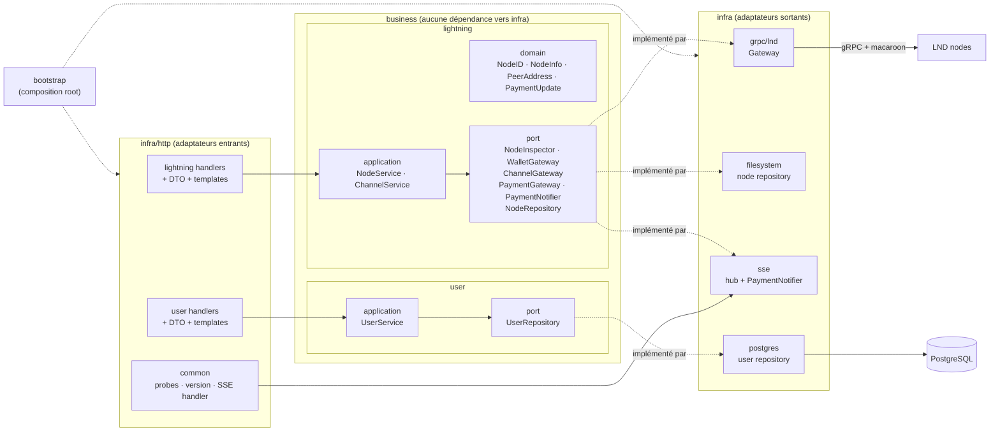

# Architecture du backend (hexagonale)

Le backend Go (`backend/internal/`) suit une architecture hexagonale (ports & adapters) :
le métier ne connaît ni HTTP, ni gRPC, ni PostgreSQL ; ce sont les adaptateurs de `infra/` qui s'adaptent au métier.



## Règle de dépendance
`business/` n'importe **jamais** `infra/`, `bootstrap/`, `testsupport/`, les types protobuf LND (`backend/gRPC`) ni la config racine,
et les deux contextes (`lightning`, `user`) ne s'importent pas entre eux.
Cette règle est vérifiée automatiquement par `backend/internal/archtest/architecture_test.go`.

## Arborescence
```
backend/
  cmd/                      point d'entrée (main.go + migrations au démarrage)
  gRPC/                     .proto LND + stubs générés (ne pas éditer à la main)
  internal/
    business/
      lightning/            domain/  port/  application/
      user/                 domain/  port/  application/
    infra/
      http/common/          helpers (réponses JSON/HTMX, Fail), probes, version, handler SSE
      http/lightning/       handlers, DTO, templates HTMX embarqués (go:embed)
      http/user/            handlers, DTO, view model, templates HTMX embarqués
      grpc/lnd/             Gateway (client LND), fabrique de clients gRPC, résolution des connexions
      postgres/             connexion + repository des utilisateurs
      filesystem/           repository des nœuds (dossiers sous NODE_STORAGE)
      sse/                  hub SSE + PaymentNotifier
    bootstrap/              composition root (câblage manuel) + routeur
    shared/exception/       AppError (file:line + chaîne de causes)
    testsupport/            mocks + TestHarness
    integration/            tests d'intégration via le vrai routeur
    archtest/               test de la règle de dépendance
```

## Contexte `lightning`

| Couche | Contenu |
|--------|---------|
| `domain` | `NodeID` (validé : lettres, chiffres, `_`, `-`), `NodeSummary` (avec `WalletState`), `NodeInfo`, `PeerAddress` (`pubkey@host`), `PaymentUpdate`, `WalletState` (`IsReady` : `rpc_active` et `server_active`), erreurs métier (`ErrInvalidNodeID`, `ErrInvalidPeerAddress`, `ErrInvalidAmount`) |
| `port` (sortants) | `NodeRepository`, `NodeInspector` (`GetSummary`, `GetWalletState`, `GetInfo`, `UpdateAppearance`), `WalletGateway` (`Unlock`), `ChannelGateway`, `PaymentGateway`, `PaymentProgress`, `PaymentNotifier` |
| `application` | `NodeService` (lister, infos, URI, alias/couleur, déverrouillage du wallet), `ChannelService` (peer, canal, facture, paiement) |
| adaptateurs | `grpc/lnd.Gateway` implémente `NodeInspector` + `WalletGateway` + `ChannelGateway` + `PaymentGateway` ; `filesystem` → `NodeRepository` ; `sse.PaymentNotifier` → `PaymentNotifier` ; `http/lightning` appelle les services |

Les erreurs de validation du métier sont des sentinelles (`errors.Is`) : le handler répond **400** pour elles et **500** pour les autres.

## Contexte `user`
Exemple minimal : `UserService.List` → port `UserRepository` → `infra/postgres`.
Le JSON est produit par un DTO de `infra/http/user` (le domaine n'a pas de tags JSON).

## Routes HTTP
Les handlers répondent en HTML (fragments HTMX) si l'en-tête `HX-Request: true` est présent, sinon en JSON.

| Route | Méthode | Cas d'usage |
|-------|---------|-------------|
| `/lightning/nodes` | GET | liste de tous les nœuds avec l'état de leur wallet (`walletState`, libellé `walletLabel`) |
| `/lightning/nodeInfo?id=` | GET | état d'un nœud |
| `/lightning/uri?id=` | GET | première URI publique du nœud |
| `/lightning/wallet/unlock` | POST | déverrouiller le wallet (`id`, `password` dans le corps uniquement) ; `HX-Trigger: wallet-unlocked` si succès |
| `/lightning/peer` | POST | connecter un peer (`id`, `uri`) |
| `/lightning/channel` | POST | ouvrir un canal (`id`, `pubKey`, `amount`) |
| `/lightning/channels` | GET | lister les canaux ouverts et en attente (`id`) ; JSON ou HTMX (`channels.html`) |
| `/lightning/channel/close` | POST | fermer un canal (`id`, `channelPoint` `txid:index`, `force` optionnel, défaut `false`) ; `HX-Trigger: channel-closed` si succès. Pré-contrôle applicatif : canal inconnu, non fermable ou pair hors ligne (fermeture coopérative) -> 400 |
| `/lightning/invoice` | POST | créer une facture (`id`, `memo`, `amount`) |
| `/lightning/paiment` | POST | payer une facture (`id`, `paymentRequest`), progression via SSE |
| `/lightning/alias` | PUT | changer alias et couleur (`id`, `alias`, `color`) |
| `/users` | GET | liste des utilisateurs (démo) |
| `/stream-event` | GET | flux SSE (notifications de paiement) |
| `/health`, `/ready`, `/version`, `/metrics` | GET | sondes, version, métriques Prometheus |

## Exemple de flux : liste des nœuds
```
GET /lightning/nodes
  → http/lightning.HandleListOfNodes        (JSON, ou fragment HTMX si HX-Request)
  → application.NodeService.ListNodes       ids lus par le NodeRepository (filesystem)
  → grpc/lnd.Gateway.GetWalletState         lnrpc.State/GetState (pas besoin de GetInfo)
      erreur (dial, macaroon, RPC)          → state "unreachable", le nœud est tout de même listé
  → grpc/lnd.Gateway.GetSummary             GetInfo (alias, couleur), seulement si rpc_active ou server_active
      erreur                                → nœud gardé, sans alias ni couleur
  ← walletState (valeur brute) + walletLabel (Unlocked / Starting / Locked / No wallet / Unreachable / Unknown)
```
Limite connue : un nœud sans wallet créé n'a pas de `admin.macaroon`, donc la connexion échoue et le nœud apparaît `Unreachable` ; en pratique le libellé `No wallet` n'est donc pas atteint.

## Exemple de flux : déverrouillage du wallet
```
POST /lightning/wallet/unlock          (id et password dans le corps uniquement, jamais dans la query string)
  → http/lightning.HandleUnlockWallet       lit le password avec PostFormValue, valide l'id
  → application.NodeService.UnlockWallet    password vide → ErrWalletPasswordRequired (400)
      → NodeInspector.GetWalletState        lnrpc.State/GetState ; erreur (nœud injoignable) → 500, pas d'appel à Unlock
      → état non_existing → ErrWalletNotCreated (400) ; état autre que locked → ErrWalletNotLocked (400)
  → port WalletGateway.Unlock               ← grpc/lnd.Gateway : lnrpc.WalletUnlocker/UnlockWallet (synchrone)
      message LND "invalid passphrase"           → ErrInvalidWalletPassword (400)
      "already unlocked" / "wallet not found"    → ErrWalletNotLocked / ErrWalletNotCreated (400)
      autre erreur                               → 500
  ← succès : HX-Trigger: wallet-unlocked (aussi hors HTMX) + toast de succès
    erreur : toast d'erreur sans HX-Trigger (messages constants, le mot de passe n'apparaît jamais)
```
Côté frontend (`frontend/templates/node.html`), le bouton 🔓 n'apparaît que sur les nœuds `locked` et ouvre une `<dialog>` qui demande le mot de passe.
La requête passe par le proxy `/api/`. En cas de succès, la dialogue se ferme et la liste se rafraîchit ; tant qu'un nœud est en démarrage (`data-starting`, libellé `Starting`), la liste est rechargée toutes les 3 s jusqu'à passer à `Unlocked`.
La commande `lncli ... unlock` reste possible en parallèle. La création d'un wallet (`InitWallet`) n'est pas gérée par l'application.

## Exemple de flux : paiement d'une facture
```
POST /lightning/paiment
  → http/lightning.HandleMakePayment        valide l'id (domain.ParseNodeID) et la requête
  → application.ChannelService.Pay          appelle le port PaymentGateway
  → grpc/lnd.Gateway.PayInvoice             estime les frais (+20 %), ouvre le flux SendPaymentV2 vers LND
  ← 204 / message HTMX "Processing in progress"          (la requête HTTP se termine ici)
  → port PaymentNotifier.Watch(progress)    ← sse.PaymentNotifier
  → hub SSE : chaque PaymentUpdate est diffusé à tous les clients de /stream-event
```
Le flux de paiement survit à la requête HTTP (contexte détaché avec `context.WithoutCancel`) ; la connexion gRPC est fermée à la fin du flux.

## Base de données
PostgreSQL, table `users` uniquement (données de démonstration). Migrations golang-migrate dans `migrations/`, exécutées au démarrage du backend.
Connexion via `POSTGRES_DSN`. Déployée par Helm (Bitnami) sur Kubernetes (`make deploy-postgres`) et par un service `postgres` dans `docker-compose.yml`.

## Tests
- Unitaires par couche : domaine, application (ports mockés), `grpc/lnd` (clients LND mockés via `testsupport.GrpcClientFactoryMock`).
- Intégration (`integration/`) : vrai routeur, vrais services et adaptateurs, repositories et clients LND mockés (`TestHarness`), JSON et HTMX.
- Architecture : `archtest`.

## Erreurs
`exception.NewError(message, cause)` crée une `*AppError` qui mémorise `fichier:ligne` et la cause ; la chaîne s'affiche niveau par niveau
dans les logs (`common.LogException`) et reste compatible avec `errors.Is` / `errors.As`.

## Limites connues

Le playground tourne sur simnet et n'a pas d'authentification. Risques connus et acceptés pour la route `POST /lightning/wallet/unlock` :
- **Pas d'authentification, de protection CSRF ni de limitation de débit.** C'est le cas de toutes les routes qui modifient l'état (`/lightning/paiment`, `/lightning/channel`, ...). Une page web ouverte dans le même navigateur peut donc envoyer des tentatives de mot de passe. Les wallets sont des wallets simnet sans valeur, et le déverrouillage ne déplace aucun fonds.
- **Mot de passe transmis en HTTP clair** entre le navigateur et le frontend. `docker-compose.yml` publie `${FRONTEND_PORT}` sur toutes les interfaces, et l'ingress Kubernetes n'a pas de section `tls:`. Ne pas exposer l'application en dehors de la machine locale.
- **Mot de passe conservé en mémoire** sous forme de `string` Go, donc non effaçable.
- **Messages d'erreur LND** : le backend reconnaît les échecs par leur texte (`invalid passphrase`, `already unlocked`, `wallet not found`), ce qui suppose LND v0.20. Une autre version peut changer ces textes.
