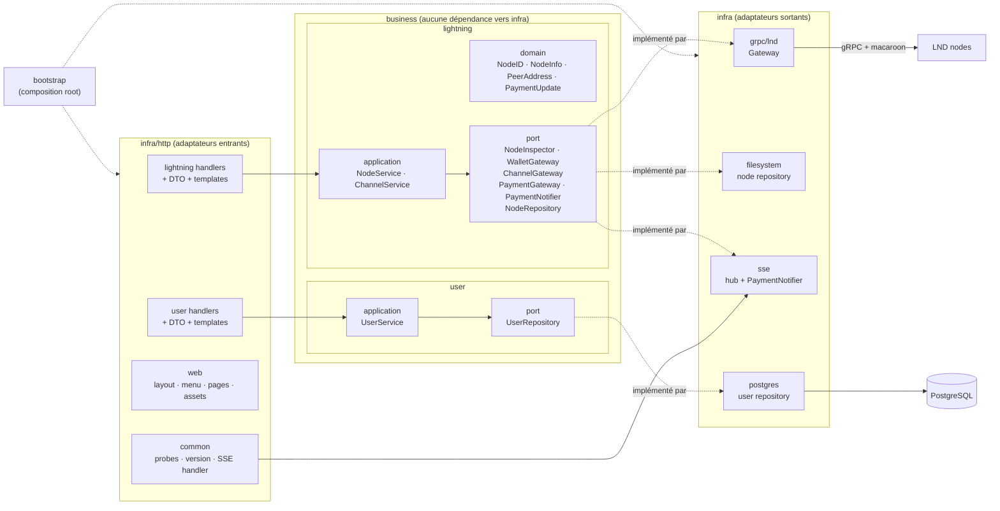

# Architecture du backend (hexagonale)

Le backend Go (`backend/internal/`) suit une architecture hexagonale (ports & adapters) :
le métier ne connaît ni HTTP, ni gRPC, ni PostgreSQL ; ce sont les adaptateurs de `infra/` qui s'adaptent au métier.



## Règle de dépendance
`business/` n'importe **jamais** `infra/`, `bootstrap/`, `testsupport/`, les types protobuf LND (`backend/gRPC`) ni la config racine,
et les deux contextes (`lightning`, `user`) ne s'importent pas entre eux.
Cette règle est vérifiée automatiquement par `backend/internal/archtest/architecture_test.go`.

## Arborescence
```
backend/
  cmd/                      point d'entrée (main.go + migrations au démarrage)
  gRPC/                     .proto LND + stubs générés (ne pas éditer à la main)
  internal/
    business/
      lightning/            domain/  port/  application/
      user/                 domain/  port/  application/
    infra/
      http/common/          helpers (réponses JSON/HTMX, Fail), probes, version, handler SSE
      http/web/             layout, menu (OOB), pages d'accueil, assets statiques (go:embed, sous /asset/)
      http/lightning/       handlers, DTO, templates HTMX embarqués (go:embed), route /node/panel
      http/user/            handlers, DTO, view model, templates HTMX embarqués
      grpc/lnd/             Gateway (client LND), fabrique de clients gRPC, résolution des connexions
      postgres/             connexion + repository des utilisateurs
      filesystem/           repository des nœuds (dossiers sous NODE_STORAGE)
      sse/                  hub SSE + PaymentNotifier
    bootstrap/              composition root (câblage manuel) + deux routeurs (app, ops)
    shared/exception/       AppError (file:line + chaîne de causes)
    testsupport/            mocks + TestHarness
    integration/            tests d'intégration via le vrai routeur
    archtest/               test de la règle de dépendance
```

## Contexte `lightning`

| Couche | Contenu |
|--------|---------|
| `domain` | `NodeID` (validé : lettres, chiffres, `_`, `-`), `NodeSummary` (avec `WalletState`), `NodeInfo`, `PeerAddress` (`pubkey@host`), `Channel` (canal ouvert ou en attente : `Point`, `RemotePubKey`, `CapacitySat`, `LocalBalanceSat`, `RemoteBalanceSat`, `Status`, méthode `IsClosable`), `ChannelPoint` (`txid:index`, parsé par `ParseChannelPoint` : txid de 64 hex en minuscules, index `uint32`), `ChannelStatus` (`active`, `inactive`, `pending_open`, `closing`, `force_closing`), `PaymentUpdate`, `WalletState` (`IsReady` : `rpc_active` et `server_active`), `Balance` (`OnChainBalance` confirmé/non confirmé/verrouillé/réserve anchor, `ChannelBalance` local/distant/pending-open/unsettled ; `TotalSat` calculé dans le domaine), erreurs métier (`ErrWalletNotReady`, `ErrInvalidNodeID`, `ErrInvalidPeerAddress`, `ErrInvalidAmount`, `ErrInvalidChannelPoint`, `ErrChannelNotFound`, `ErrChannelNotClosable`, `ErrChannelPeerOffline`) |
| `port` (sortants) | `NodeRepository`, `NodeInspector` (`GetSummary`, `GetWalletState`, `GetInfo`, `UpdateAppearance`), `WalletGateway` (`Unlock`, `GetBalance`), `ChannelGateway` (`AddPeer`, `OpenChannel`, `ListChannels`, `CloseChannel`), `PaymentGateway`, `PaymentProgress`, `PaymentNotifier` |
| `application` | `NodeService` (lister, infos, URI, alias/couleur, déverrouillage du wallet, solde), `ChannelService` (peer, ouverture, liste et fermeture de canaux, facture, paiement) |
| adaptateurs | `grpc/lnd.Gateway` implémente `NodeInspector` + `WalletGateway` + `ChannelGateway` + `PaymentGateway` ; `filesystem` → `NodeRepository` ; `sse.PaymentNotifier` → `PaymentNotifier` ; `http/lightning` appelle les services |

Les erreurs de validation du métier sont des sentinelles (`errors.Is`) : le handler répond **400** pour elles et **500** pour les autres.

## Contexte `user`
Exemple minimal : `UserService.List` → port `UserRepository` → `infra/postgres`.
Le JSON est produit par un DTO de `infra/http/user` (le domaine n'a pas de tags JSON).

## Routes HTTP
Le backend est le seul serveur web de l'application : il sert les pages, les assets statiques, les fragments HTMX et le JSON. Il n'y a plus de service frontend.
Les handlers répondent en HTML (fragments HTMX) si l'en-tête `HX-Request: true` est présent, sinon en JSON (réponses avec `Vary: HX-Request`). Les pages (`/`, `/hello`, `/person`, `/node`) et `/node/panel` sont HTML uniquement.

### Ports
| Port | Variable | Contenu | Exposition |
|------|----------|---------|------------|
| app `8080` | `BACKEND_PORT` | pages, `/asset/`, `/node/panel`, `/lightning/*`, `/users`, `/stream-event`, `/version` | compose : `3000:8080` ; ingress `app-ingress` (service `backend`, port `backend`) |
| ops `9090` | `BACKEND_OPS_PORT` | `/health`, `/ready`, `/metrics` | interne au cluster uniquement (probes, ServiceMonitor, port `ops`) ; non publié par compose ni par l'ingress |

Les deux listeners sont ouverts (`net.Listen`) avant le `Serve` de l'un ou l'autre, pour que `/ready` ne réponde pas avant que l'app écoute. Les deux routeurs partagent un registre Prometheus ; seul le routeur app compte les requêtes (`http_requests_total`), donc les sondes et les scrapes ne sont pas comptés. Sur le port app, `/health`, `/ready` et `/metrics` renvoient 404.

### Routes
| Route | Méthode | Cas d'usage |
|-------|---------|-------------|
| `/`, `/hello` | GET | page d'accueil (HTML uniquement) |
| `/node` | GET | page des nœuds (HTML uniquement, liste chargée par `hx-get="/lightning/nodes"`) |
| `/node/panel?id=` | GET | fragment HTML du panneau d'un nœud (HTML uniquement) ; n'appelle aucun service, les sections se chargent ensuite ; `HX-Trigger: node-selected` ; id invalide → toast d'erreur |
| `/person` | GET | page des utilisateurs (HTML uniquement) |
| `/asset/...` | GET | assets statiques embarqués (JS, CSS, images) ; pas de listing de répertoire |
| `/lightning/nodes` | GET | liste de tous les nœuds avec l'état de leur wallet (`walletState`, libellé `walletLabel`) ; `?selected=` (HTMX) marque la ligne sélectionnée (`aria-current`) |
| `/lightning/nodeInfo?id=` | GET | état d'un nœud |
| `/lightning/uri?id=` | GET | première URI publique du nœud |
| `/lightning/wallet/unlock` | POST | déverrouiller le wallet (`id`, `password` dans le corps uniquement) ; `HX-Trigger: wallet-unlocked` si succès |
| `/lightning/peer` | POST | connecter un peer (`id`, `uri`) |
| `/lightning/channel` | POST | ouvrir un canal (`id`, `pubKey`, `amount`) |
| `/lightning/balance` | GET | solde on-chain et canaux (`id`) ; JSON ou HTMX (`balance.gohtml`) ; 400 "The wallet is not unlocked." si le wallet n'est pas prêt |
| `/lightning/channels` | GET | lister les canaux ouverts et en attente (`id`) ; JSON ou HTMX (`channels.gohtml`) |
| `/lightning/channel/close` | POST | fermer un canal (`id`, `channelPoint` `txid:index`, `force` optionnel, défaut `false`) ; `HX-Trigger: channel-closed` si succès. Pré-contrôle applicatif : canal inconnu, non fermable ou pair hors ligne (fermeture coopérative) -> 400 |
| `/lightning/invoice` | POST | créer une facture (`id`, `memo`, `amount`) |
| `/lightning/paiment` | POST | payer une facture (`id`, `paymentRequest`), progression via SSE |
| `/lightning/alias` | PUT | changer alias et couleur (`id`, `alias`, `color`) |
| `/users` | GET | liste des utilisateurs (démo) |
| `/stream-event` | GET | flux SSE (notifications de paiement) |
| `/version` | GET | version (port app) |
| `/health`, `/ready`, `/metrics` | GET | sondes et métriques Prometheus (port ops `9090` uniquement) |

## Exemple de flux : liste des nœuds
```
GET /lightning/nodes
  → http/lightning.HandleListOfNodes        (JSON, ou fragment HTMX si HX-Request)
  → application.NodeService.ListNodes       ids lus par le NodeRepository (filesystem)
  → grpc/lnd.Gateway.GetWalletState         lnrpc.State/GetState (pas besoin de GetInfo)
      erreur (dial, macaroon, RPC)          → state "unreachable", le nœud est tout de même listé
  → grpc/lnd.Gateway.GetSummary             GetInfo (alias, couleur), seulement si rpc_active ou server_active
      erreur                                → nœud gardé, sans alias ni couleur
  ← walletState (valeur brute) + walletLabel (Unlocked / Starting / Locked / No wallet / Unreachable / Unknown)
```
Limite connue : un nœud sans wallet créé n'a pas de `admin.macaroon`, donc la connexion échoue et le nœud apparaît `Unreachable` ; en pratique le libellé `No wallet` n'est donc pas atteint.

## Exemple de flux : déverrouillage du wallet
```
POST /lightning/wallet/unlock          (id et password dans le corps uniquement, jamais dans la query string)
  → http/lightning.HandleUnlockWallet       lit le password avec PostFormValue, valide l'id
  → application.NodeService.UnlockWallet    password vide → ErrWalletPasswordRequired (400)
      → NodeInspector.GetWalletState        lnrpc.State/GetState ; erreur (nœud injoignable) → 500, pas d'appel à Unlock
      → état non_existing → ErrWalletNotCreated (400) ; état autre que locked → ErrWalletNotLocked (400)
  → port WalletGateway.Unlock               ← grpc/lnd.Gateway : lnrpc.WalletUnlocker/UnlockWallet (synchrone)
      message LND "invalid passphrase"           → ErrInvalidWalletPassword (400)
      "already unlocked" / "wallet not found"    → ErrWalletNotLocked / ErrWalletNotCreated (400)
      autre erreur                               → 500
  ← succès : HX-Trigger: wallet-unlocked (aussi hors HTMX) + toast de succès
    erreur : toast d'erreur sans HX-Trigger (messages constants, le mot de passe n'apparaît jamais)
```
Côté interface (`lightning/templates/nodes.gohtml` et `nodePage.gohtml`), le bouton 🔓 n'apparaît que sur les nœuds `locked` et ouvre une `<dialog>` qui demande le mot de passe.
La requête part directement vers `/lightning/wallet/unlock` (même origine). En cas de succès, la dialogue se ferme (événement `wallet-unlocked`, écouté dans `web/static/js/generic.js`) et la liste se rafraîchit ; tant qu'un nœud est en démarrage (`data-starting`, libellé `Starting`), la liste est rechargée toutes les 3 s jusqu'à passer à `Unlocked`. Le panneau du nœud sélectionné n'est pas rechargé après le déverrouillage : il faut cliquer à nouveau sur la ligne.
La commande `lncli ... unlock` reste possible en parallèle. La création d'un wallet (`InitWallet`) n'est pas gérée par l'application.

## Exemple de flux : fermeture d'un canal
```
POST /lightning/channel/close           (id, channelPoint = "txid:index", force optionnel, défaut false ; dans le corps uniquement)
  → http/lightning.HandleCloseChannel        ParseForm ; valide l'id ; force vide → false, sinon strconv.ParseBool (400 si invalide)
  → application.ChannelService.CloseChannel
      1. domain.ParseChannelPoint            format invalide → ErrInvalidChannelPoint (400), pas d'appel LND
      2. port ChannelGateway.ListChannels    erreur → 500, pas de fermeture
      3. pré-contrôle sur le canal trouvé :
           absent → ErrChannelNotFound (400)
           pending_open, closing, force_closing → ErrChannelNotClosable (400)
           inactive et force=false → ErrChannelPeerOffline (400)
  → port ChannelGateway.CloseChannel     ← grpc/lnd.Gateway : lnrpc.Lightning/CloseChannel (flux)
      lit seulement la première mise à jour (ClosePending ou ChanClose) → txid
          txid : octets inversés puis encodés en hex (convention de chainhash)
      erreur RPC, erreur de réception ou autre type de mise à jour → 500
      le flux est ensuite annulé ; LND poursuit la fermeture seul
  ← succès : 200 JSON {"closingTxId"} ; HTMX : toast "Channel closing, tx <8 premiers caractères>" ; HX-Trigger: channel-closed (aussi hors HTMX)
    erreur métier : 400 avec message constant, sans HX-Trigger ; autre erreur : 500 "Unable to close the channel."
```

Le solde est lu par `GET /lightning/balance` :

```
http/lightning.HandleGetBalance → application.NodeService.GetBalance
  → NodeInspector.GetWalletState ; état non prêt → ErrWalletNotReady (400), sans appel au gateway
  → WalletGateway.GetBalance ← grpc/lnd.Gateway : WalletBalance puis ChannelBalance (une erreur → 500 "Unable to get the balance.")
```

Le total (`Balance.TotalSat`) = on-chain confirmé + non confirmé + local des canaux ouverts + unsettled local + pending-open local. Les fonds des canaux en cours de fermeture (limbo) ne sont pas comptés. `lockedSat` et `reservedAnchorSat` sont informatifs : ils ne sont ni ajoutés ni retranchés du total.

Le fragment HTMX `balance.gohtml` (`http/lightning/templates`) affiche trois sections (on-chain avec ₿, canaux avec ⚡, total) en `dl`/`dt`/`dd`, chiffres en police monospace. Chaque montant en sat est suivi d'une valeur approximative en BTC (`≈ X.XX BTC`, arrondie à 2 décimales par le helper de template `formatBTC`, `templates.go`). Les attributs `data-*` des montants sont inchangés ; les emoji sont décoratifs (`aria-hidden`).

Les canaux sont lus par `GET /lightning/channels` (`grpc/lnd.Gateway.ListChannels` : `ListChannels` puis `PendingChannels`) :

| Source LND | Statut | Fermable |
|------------|--------|----------|
| `ListChannels`, `active` vrai / faux | `active` / `inactive` | oui |
| `PendingOpenChannels` | `pending_open` | non |
| `WaitingCloseChannels` | `closing` (transaction de fermeture diffusée, non confirmée) | non |
| `PendingForceClosingChannels` | `force_closing` (fermeture forcée confirmée, fonds bloqués le temps du délai CSV) | non |

`PendingClosingChannels` (déprécié) est ignoré. Un point de canal que LND renvoie mais qui n'est pas parsable fait échouer la liste (500) au lieu d'être omis.

Limites connues de la fermeture :
- Le suivi s'arrête à la diffusion : le canal reste `closing` tant que la transaction n'est pas confirmée (sur simnet, il faut miner des blocs, par exemple `btcctl --simnet generate`). Le statut n'est pas suivi par SSE.
- La fermeture coopérative attend la réponse du pair avant de répondre à la requête, et aucun timeout n'est appliqué : avec un pair muet, la requête reste ouverte.
- Pas de `NoWait`, ni de taux de frais, de cible de confirmation ou d'adresse de livraison personnalisés. Une fermeture coopérative avec des HTLC en attente échoue côté LND (500).
- L'état peut changer entre le pré-contrôle et la fermeture ; LND renvoie alors une erreur (500).
- Côté interface, la section « Channels » du panneau (`lightning/templates/nodePanel.gohtml`) charge `/lightning/channels` à la sélection d'un nœud et se rafraîchit sur `channel-closed`. La colonne du pair est un en-tête de ligne (`<th scope="row">`), avec les ids RGAA rendus côté serveur. Les boutons de fermeture (coopérative, forcée) demandent confirmation dans une fenêtre modale : `hx-confirm` est intercepté par le gestionnaire global `htmx:confirm` de `infra/http/web/static/js/generic.js`, qui ouvre le `<dialog id="confirm-dialog">` de `web/templates/layout.gohtml`. Ces boutons n'apparaissent que sur les canaux `active` / `inactive`.

## Exemple de flux : paiement d'une facture
```
POST /lightning/paiment
  → http/lightning.HandleMakePayment        valide l'id (domain.ParseNodeID) et la requête
  → application.ChannelService.Pay          appelle le port PaymentGateway
  → grpc/lnd.Gateway.PayInvoice             estime les frais (+20 %), ouvre le flux SendPaymentV2 vers LND
  ← 204 / message HTMX "Processing in progress"          (la requête HTTP se termine ici)
  → port PaymentNotifier.Watch(progress)    ← sse.PaymentNotifier
  → hub SSE : chaque PaymentUpdate est diffusé à tous les clients de /stream-event
```
Le flux de paiement survit à la requête HTTP (contexte détaché avec `context.WithoutCancel`) ; la connexion gRPC est fermée à la fin du flux.

## Base de données
PostgreSQL, table `users` uniquement (données de démonstration). Migrations golang-migrate dans `migrations/`, exécutées au démarrage du backend.
Connexion via `POSTGRES_DSN`. Déployée par Helm (Bitnami) sur Kubernetes (`make deploy-postgres`) et par un service `postgres` dans `docker-compose.yml`.

## Tests
- Unitaires par couche : domaine, application (ports mockés), `grpc/lnd` (clients LND mockés via `testsupport.GrpcClientFactoryMock`).
- Intégration (`integration/`) : vrai routeur, vrais services et adaptateurs, repositories et clients LND mockés (`TestHarness`), JSON et HTMX.
- Architecture : `archtest`.

## Erreurs
`exception.NewError(message, cause)` crée une `*AppError` qui mémorise `fichier:ligne` et la cause ; la chaîne s'affiche niveau par niveau
dans les logs (`common.LogException`) et reste compatible avec `errors.Is` / `errors.As`.

## Limites connues

Le playground tourne sur simnet et n'a pas d'authentification. Risques connus et acceptés pour la route `POST /lightning/wallet/unlock` :
- **Pas d'authentification, de protection CSRF ni de limitation de débit.** C'est le cas de toutes les routes qui modifient l'état (`/lightning/paiment`, `/lightning/channel`, ...). Une page web ouverte dans le même navigateur peut donc envoyer des tentatives de mot de passe. Les wallets sont des wallets simnet sans valeur, et le déverrouillage ne déplace aucun fonds.
- **Mot de passe transmis en HTTP clair** entre le navigateur et le backend. `docker-compose.yml` publie `3000:8080` (port app) sur toutes les interfaces, et l'ingress Kubernetes n'a pas de section `tls:`. Ne pas exposer l'application en dehors de la machine locale.
- **Mot de passe conservé en mémoire** sous forme de `string` Go, donc non effaçable.
- **Messages d'erreur LND** : le backend reconnaît les échecs par leur texte (`invalid passphrase`, `already unlocked`, `wallet not found`), ce qui suppose LND v0.20. Une autre version peut changer ces textes.
